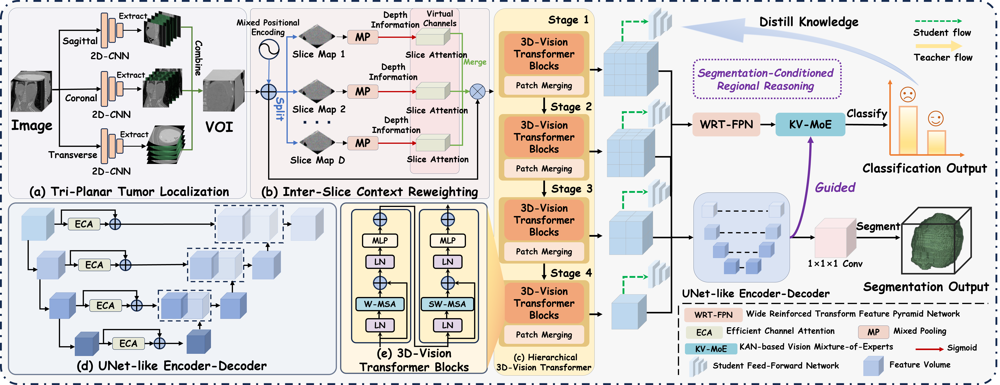

# SCoRE: Segmentation-Conditioned Regional Reasoning for Preoperative Metastatic Assessment of Wilms Tumor via Asymmetric Multi-Task Learning

[](https://github.com/wenjing-gg/SCoRE/stargazers)
[](https://github.com/wenjing-gg/SCoRE/network/members)
[](https://github.com/wenjing-gg/SCoRE)

**This repository contains the SCoRE implementation for Wilms tumor segmentation and preoperative metastatic assessment.**

SCoRE connects voxel-level tumor delineation to patient-level metastatic assessment through a directed, segmentation-conditioned regional reasoning path.

## 📄 Framework

<div align="center">
  
</div>

---

## Overview

SCoRE jointly predicts the Wilms tumor mask and metastatic status from preoperative CT. Segmentation logits condition regional features before the classifier aggregates block-level evidence. The framework incorporates:

- **Tri-planar localization** to define a tumor-centered volume of interest
- **Inter-slice context reweighting** and hierarchical three-dimensional encoding
- **WRT-FPN** cross-scale feature aggregation
- **Segmentation-conditioned KV-MoE** with Kolmogorov-Arnold Network experts
- **Uncertainty-weighted objectives and self-distillation** for joint optimization

## Requirements

See `requirements.txt` for detailed dependencies. Key requirements include:

- Python 3.8+
- PyTorch 2.4.0+
- MONAI 1.4.0+
- NumPy, SciPy, scikit-learn
- SimpleITK for medical image processing

## Installation

1. Clone the repository:
```bash
git clone https://github.com/wenjing-gg/SCoRE.git
cd SCoRE
```

2. Install dependencies:
```bash
pip install -r requirements.txt
```

## Pre-trained Weights

For initializing the SwinViT backbone, the pre-trained weights on the **BTCV abdominal dataset** can be found in the [Swin-UNETR repository](https://github.com/LeonidAlekseev/Swin-UNETR). Please download the corresponding pretrained checkpoint and specify its path when needed for training or fine-tuning.

## Usage

### Training

```bash
python train.py --data_path /path/to/your/data --epochs 100 --batch_size 2
```

### Key Parameters

- `--data_path`: Path to the dataset directory
- `--weights`: Path to pre-trained weights (optional)
- `--epochs`: Number of training epochs
- `--batch_size`: Batch size for training
- `--freeze_layers`: Whether to freeze backbone layers

## Project Structure

```text
SCoRE/
├── models/                 # Core model implementations
│   ├── score.py               # SCoRE architecture and task interaction
│   ├── FPN.py              # Feature Pyramid Network
│   ├── kan.py              # Kolmogorov-Arnold Network components
│   ├── loss.py             # Multi-task loss functions
│   └── __init__.py
├── data/                   # Data loading and preprocessing
│   ├── dataset.py          # Custom NRRD dataset implementation
│   └── __init__.py
├── utils/                  # Utility functions
│   ├── utils.py            # Training and evaluation utilities
│   ├── metrics.py          # Evaluation metrics
│   └── __init__.py
├── train.py                # Training script
├── requirements.txt        # Dependencies
└── README.md
```

## Dataset Structure

The expected dataset structure:
```text
your_data/
├── train/
│   ├── 0/  # No metastasis
│   │   ├── image1.nrrd
│   │   ├── image1_label.nrrd
│   │   └── ...
│   └── 1/  # Metastasis
│       ├── image2.nrrd
│       ├── image2_label.nrrd
│       └── ...
└── test/
    ├── 0/
    └── 1/
```

## Citation

Please cite the SCoRE paper:

```bibtex
@misc{zhu_score,
  title  = {SCoRE: Segmentation-Conditioned Regional Reasoning for Preoperative Metastatic Assessment of Wilms Tumor via Asymmetric Multi-Task Learning},
  author = {Zhu Zhu and Wenjing Yu and Wenxu Qi and Yuxin Du and Xiaohui Ma and Shuai Liu and Jie Dong and Changmiao Wang and Feiwei Qin and Gang Yu}
}
```

## License

This project is licensed under the MIT License - see the LICENSE file for details.

## Contact

For questions or issues, please contact: [yuwenjing259@gmail.com]
